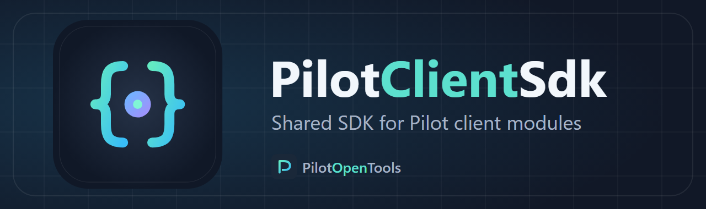

<p align="center"></p>

# PilotClientSdk

[](https://github.com/PilotOpenTools/PilotClientSdk/actions/workflows/ci.yml)
[](https://github.com/PilotOpenTools/PilotClientSdk/releases/latest)
[](https://www.nuget.org/packages/Pilot.ClientSdk)

Общий модуль для клиентских модулей Pilot-ICE Enterprise и Pilot-BIM. Модуль `113Pilot.ClientSdk.ext2` назначается пользователям на сервере Pilot, а другие модули подключают его NuGet-пакетом `Pilot.ClientSdk` и получают готовую статистику, проверку загрузки и общие методы SDK.

[Руководство](docs/guide.md) · [Скачать релиз](https://github.com/PilotOpenTools/PilotClientSdk/releases/latest) · [История изменений](CHANGELOG.md)

## Что умеет

- **Статистика модулей в Grafana.** `ModuleStats` считает вызовы действий модуля, успехи, длительность и ошибки, а также какие модули и в каких версиях загружены у пользователя. После выкладки видно, дошла ли новая версия до рабочих мест.
- **Проверка загрузки модулей.** При старте клиента окно «Загрузка модулей» показывает, все ли назначенные модули скачались, загрузились и запустились и сколько занял запуск.
- **Общие методы SDK.** Загрузка объектов, поиск, атрибуты, навигация по дереву, оргструктура, изменение данных, нумераторы, лог, команды MVVM. Без NLog и System.Reactive: в общем AppDomain клиента их версии у разных модулей конфликтуют.

```
Модуль (ModuleStats.Run …) ──Pilot.ClientSdk (клиент Pilot) ──пачка раз в 15 с──report-metrics-collector
                                                                                   │
                                     PostgreSQL metrics.module_events ──Grafana «Pilot - клиентские модули»
```

Сервис статистики и дашборд входят в [PilotProAdmin](https://github.com/PilotOpenTools/PilotProAdmin). Без них модуль работает, статистика просто выключена.

## Установка

Файлы релиза на странице [Releases](https://github.com/PilotOpenTools/PilotClientSdk/releases/latest):

| Файл | Что это |
|---|---|
| `113Pilot.ClientSdk.ext2-<версия>.zip` | модуль для загрузки на сервер Pilot (через Pilot-myAdmin или вкладку «Модули» PilotProAdmin). Назначьте его всем пользователям раньше модулей, которые на нём построены |
| `Pilot.ClientSdk.<версия>.nupkg` | NuGet-пакет для разработчиков модулей: сборка в `ref/net48`, только для компиляции |
| `SHA256SUMS.txt` | контрольные суммы |

Пакет `Pilot.ClientSdk` публикуется в [nuget.org](https://www.nuget.org/packages/Pilot.ClientSdk): отдельный источник пакетов модулю не нужен.

```powershell
dotnet add package Pilot.ClientSdk
```

```xml
<PackageReference Include="Pilot.ClientSdk" Version="2.1.2" />
```

Тот же пакет лежит в [GitHub Packages](https://github.com/PilotOpenTools/PilotClientSdk/pkgs/nuget/Pilot.ClientSdk) (нужен вход с токеном `read:packages`) и файлом в релизе - для закрытого контура его кладут в реестр пакетов своего GitLab.

Сборка в пакете не копируется в `bin` и в zip вашего модуля: в клиенте её уже загрузил `113Pilot.ClientSdk.ext2`, вторая копия дала бы конфликт типов.

## Быстрый старт

```csharp
using Pilot.ClientSdk;
using Pilot.ClientSdk.Telemetry;

[Export(typeof(IMenu<ObjectsViewContext>))]
public class StartPoint : IMenu<ObjectsViewContext>, IModule
{
    private static readonly ModuleStats Stats = ModuleStats.For<StartPoint>();

    [ImportingConstructor]
    public StartPoint(IObjectsRepository repository, ISearchService search, IObjectModifier modifier)
    {
        PilotApi.Init(repository, search, modifier);
        StartupRunner.Run(this);          // последней строкой: замер запуска для окна загрузки
    }

    public void Initialize() { }

    public void Build(IMenuBuilder builder, ObjectsViewContext context) =>
        builder.AddItem("Count", 0).WithHeader("Посчитать документы");

    public async void OnMenuItemClick(string name, ObjectsViewContext context) =>
        await Stats.RunAsync("Посчитать документы", async op =>
        {
            var docs = await PilotApi.Searcher.ByTypeAsync("pir_doc");
            op.Items = docs.Count;        // сколько обработано - в Grafana
        });
}
```

Полный пример, API статистики, стартовый класс `IModule`, список общих методов и переход со старого `NugetPackage`: [docs/guide.md](docs/guide.md).

## Требования

- Клиент Pilot-ICE Enterprise или Pilot-BIM (проверено на 26.13), .NET Framework 4.8.
- Для сборки: .NET SDK 8 или новее (в CI - 10.0). Отладка в клиенте только на Windows.

## Сборка и тесты

```powershell
dotnet build Pilot.ClientSdk.sln -c Release   # bin\113Pilot.ClientSdk.ext2-<версия>.zip
dotnet test Pilot.ClientSdk.sln -c Release
dotnet pack Pilot.ClientSdk.csproj -c Release -o artifacts
```

Debug-сборка копирует модуль в `%LocalAppData%\ASCON\Pilot-BIM\Development\113Pilot.ClientSdk.ext2`, и клиент подхватывает его без загрузки на сервер; `-p:CopyToPilot=false` отключает копирование.

## Выпуск

1. Поднимите `<Version>` в [Pilot.ClientSdk.csproj](Pilot.ClientSdk.csproj) и добавьте в [CHANGELOG.md](CHANGELOG.md) раздел `## [X.Y.Z] - дата`.
2. Поставьте и отправьте тег:

   ```powershell
   git tag -a vX.Y.Z -m "vX.Y.Z"
   git push origin main vX.Y.Z
   ```

3. Workflow [release.yml](.github/workflows/release.yml) сверит тег с версией, соберёт и проверит решение, опубликует релиз с zip модуля, пакетом и контрольными суммами и отправит пакет в GitHub Packages и nuget.org. Описание релиза берётся из раздела версии в `CHANGELOG.md`.

Публикация в nuget.org идёт через [Trusted Publishing](https://learn.microsoft.com/nuget/nuget-org/trusted-publishing): задание получает от GitHub токен OIDC и меняет его в nuget.org на ключ API, который живёт час. Постоянного ключа нет ни в репозитории, ни в секретах, поэтому открытый репозиторий ничем не рискует. Политика на nuget.org (профиль `tsaregorlionheart`, раздел Trusted Publishing): владелец `PilotOpenTools`, репозиторий `PilotClientSdk`, файл `release.yml`. Версия в nuget.org необратима: её можно только скрыть.

В GitLab стенда PilotProAdmin модуль ведётся по схеме веток `dev` / `release/*` / `main` с выкладкой на тест, стейдж и прод: этим занимается [.gitlab-ci.yml](.gitlab-ci.yml), подробно в [руководстве](docs/guide.md#4-сборка-выпуск-cicd).

## Участие

Правила участия: [CONTRIBUTING.md](https://github.com/PilotOpenTools/.github/blob/main/CONTRIBUTING.md). Кодекс поведения: [CODE_OF_CONDUCT.md](https://github.com/PilotOpenTools/.github/blob/main/CODE_OF_CONDUCT.md).

## Лицензия

Проект распространяется по лицензии [Apache 2.0](LICENSE).
